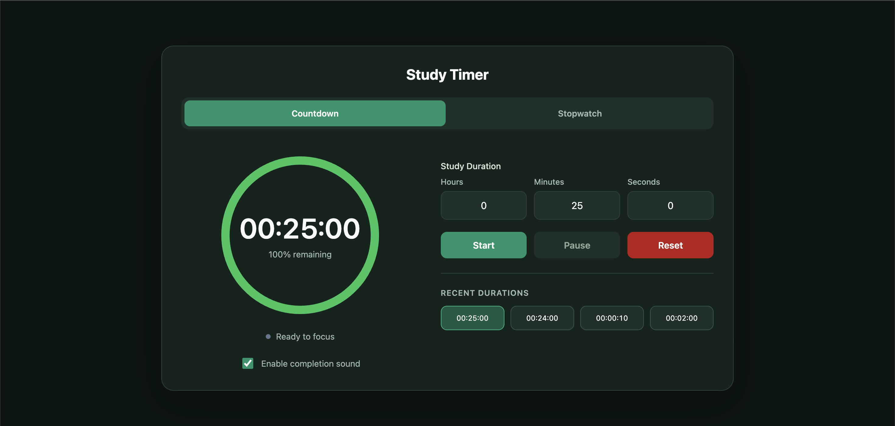
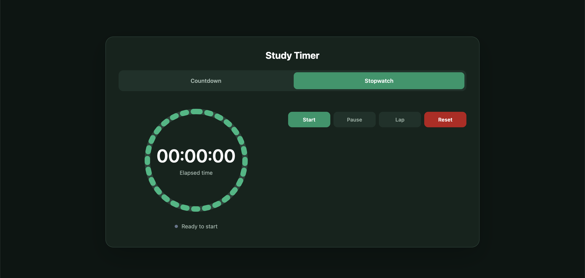

# Study Timer

A customizable study timer and stopwatch application built with React and TypeScript to help users manage focused study sessions and track elapsed time.

The application features flexible countdown durations, a color coded progress indicator, reusable recent durations, completion notifications and a stopwatch with lap tracking.

## Screenshots

### Countdown Timer



### Stopwatch with Lap Tracking



## Features

### Countdown Timer

- **Custom Study Durations:** Set a countdown using hours, minutes and seconds.
- **Timer Controls:** Start, pause, resume and reset study sessions.
- **Visual Progress Indicator:** A circular countdown that changes color as time runs out:
  - Green: More than 50% remaining
  - Yellow: 15–50% remaining
  - Red: 15% or less remaining
- **Recent Durations:** Automatically remembers the four most recently used unique durations.
- **Persistent Preferences:** Saves recent durations and sound settings using browser localStorage.
- **Completion Alarm:** Plays an audible notification when the countdown reaches zero.
- **Sound Controls:** Enable or disable the completion alarm.
- **Completion Feedback:** Displays a completion message and updates the browser tab title.

### Stopwatch

- **Elapsed Time Tracking:** Measure elapsed time in hours, minutes and seconds.
- **Stopwatch Controls:** Start, pause, resume and reset the stopwatch.
- **Lap Tracking:** Record individual lap durations without stopping the stopwatch.
- **Lap History:** View recorded lap times alongside cumulative elapsed times.
- **Accurate Timing:** Uses timestamps to calculate elapsed time and reduce accumulated timing drift.

### User Interface

- **Dual Modes:** Switch between Countdown and Stopwatch modes without resetting either mode's state.
- **Responsive Layout:** A horizontal, two-column interface on desktop that adapts to smaller screens.
- **Emerald Green Theme:** A dark interface with emerald accents and distinct visual indicators.
- **Accessibility:** Keyboard focus indicators, labeled inputs and accessible timer status.
- **No Account Required:** All features run directly in the browser.

## Technologies Used

- **React** — Component based user interface
- **TypeScript** — Type-safe application logic
- **Vite** — Development server and production builds
- **CSS** — Styling, responsive layouts and visual indicators
- **Web Audio API** — Completion alarm
- **Browser localStorage** — Persistent user preferences and recent durations
- **Git and GitHub** — Version control and project management

## Getting Started

### Prerequisites

- Node.js and npm

### Installation

1. Clone the repository:

   ```bash
   git clone https://github.com/chrislff02/study-timer.git
   ```

2. Navigate into the project:

   ```bash
   cd study-timer
   ```

3. Install dependencies:

   ```bash
   npm install
   ```

4. Start the development server:

   ```bash
   npm run dev
   ```

5. Open the local URL displayed in the terminal.

## Available Commands

| Command           | Description                          |
| ----------------- | ------------------------------------ |
| `npm run dev`     | Start the development server         |
| `npm run build`   | Build the application for production |
| `npm run preview` | Preview the production build         |
| `npm run lint`    | Run ESLint                           |

## How to Use

### Countdown Mode

1. Select the **Countdown** tab.
2. Enter a study duration using the Hours, Minutes and Seconds fields.
3. Click **Start** to begin the countdown.
4. Use **Pause**, **Resume**, or **Reset** to control the session.
5. Watch the circular progress indicator change color as time decreases.
6. When the timer reaches zero, a completion message appears and an alarm plays if sound is enabled.
7. Select a previously used duration from the Recent Durations section to quickly reuse it.

### Stopwatch Mode

1. Select the **Stopwatch** tab.
2. Click **Start** to begin tracking elapsed time.
3. Click **Lap** to record the current interval.
4. View individual lap durations and cumulative elapsed times in the lap history.
5. Use **Pause** and **Resume** to temporarily stop and continue tracking.
6. Click **Reset** to clear the stopwatch and recorded laps.

You can switch between Countdown and Stopwatch modes without resetting either one.

## Project Highlights

### Accurate Time Tracking

The countdown uses a target completion timestamp to calculate remaining time rather than relying solely on interval ticks. This reduces accumulated timing drift when browser tabs become inactive.

The stopwatch uses a similar timestamp approach to measure elapsed time and calculate lap durations.

### Persistent Browser Storage

Recent countdown durations are stored in seconds and maintained as a list of the four most recently used unique values.

The application also saves the user's completion sound preference using browser localStorage.

### Independent Timer Modes

Countdown and Stopwatch are implemented as separate React components, allowing each feature to manage its own state.

Switching between modes preserves active timing sessions without resetting their progress.

### Responsive Design

The application uses a horizontal, two-column layout on larger screens, separating the timing display from the controls and additional features.

On smaller screens, the interface adjusts to a vertical layout for improved usability.

### Client-Side Architecture

The application runs entirely in the browser and does not require a backend, database, or user authentication.

## Project Structure

```text
study-timer/
├── public/
├── src/
│   ├── components/
│   │   ├── CountdownTimer.tsx
│   │   └── Stopwatch.tsx
│   ├── App.tsx
│   ├── App.css
│   ├── index.css
│   └── main.tsx
├── index.html
├── package.json
└── README.md
```
